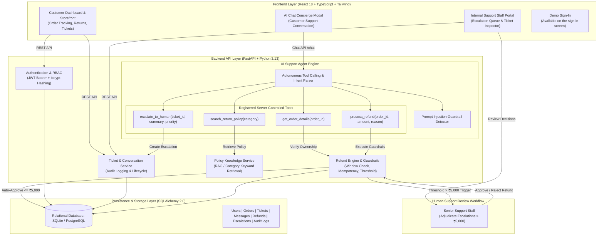
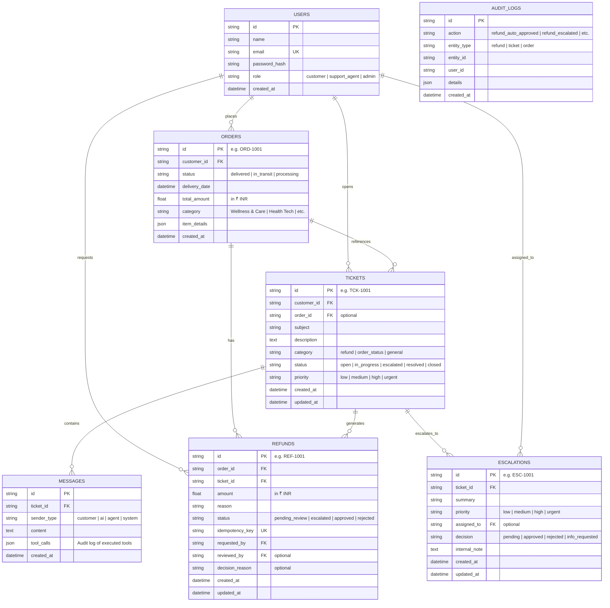

# KINETIC — E-Commerce AI Support & Refund Operations Engine

A production-grade full-stack web application designed for modern e-commerce platforms. It empowers customers to raise support tickets, view live order details, chat with an autonomous AI support agent with multi-turn reasoning and tool-calling capabilities, and request refunds subject to strict business guardrails. Support staff can review tickets, manage escalations, and approve or reject high-value refund requests (> ₹5,000).

## 🏗️ Architecture Diagram



---

## 🗄️ Database Entity-Relationship (ER) Diagram



---

## 🛡️ Mandatory Business Rules & Guardrails Implementation

| Scenario | Rule Requirement | Technical Implementation |
|---|---|---|
| **Missing Order ID** | Clarification required before tool call | Agent detects missing order reference, prompts the customer for their Order ID, and refuses to call `process_refund`. |
| **Eligible Refund** | Automatic approval for qualifying orders | Checks ownership, verifies delivery date against category return window (e.g. 14 days), checks amount &le; ₹5,000, and creates an approved refund record. |
| **Expired Return Window** | Rejection with transparent explanation | If days since delivery &gt; policy window, auto-approval is blocked, the policy outcome is recorded, and the ticket is updated. |
| **Refund Above ₹5,000** | Strict Human-in-the-Loop escalation | Server blocks auto-execution if amount &gt; ₹5,000, creates an Escalation with `urgent/high` priority, and routes to staff portal for review. |
| **Unauthorized Order Access** | Prevent cross-account data exposure | Customer can only query orders matching their authenticated `customer_id`. Inaccessible orders return generic 404 without leaking info. |
| **Prompt Injection Attempt** | Neutralize jailbreaks & override attempts | Sanitization regex and server-side authorization prevent prompt injection from bypassing business limits or policies. |
| **Duplicate Submission** | Prevent double refunds | Idempotency keys and order-level refund existence checks block duplicate transactions. |
| **System / Tool Failure** | Graceful error handling | Controlled exception boundaries ensure the backend never reports false success. |

---

## 🚀 Quick Start Guide

### Prerequisites
- **Python 3.11+** (Python 3.13 tested)
- **Node.js 18+** & **npm**

---

### Step 1: Backend Setup & Seed Data
```bash
# Navigate to project root
cd /path/to/assign2

# Create and activate virtual environment
python3 -m venv backend/venv
source backend/venv/bin/activate

# Install dependencies
pip install -r backend/requirements.txt

# Configure Gemini for local general-chat responses (keys remain on your machine)
cp .env.example .env
# Optional: add a provider API key for hosted general-chat replies. The app works without one.

# Run initial database seeding
python -m backend.app.seed_data
```

The backend requirements include `psycopg2-binary` for PostgreSQL URLs, avoiding a local
build of `psycopg2`. SQLite remains the default if `DATABASE_URL` is not set.

Groq is used for general conversational replies when `LLM_PROVIDER="groq"`; the default model is
`openai/gpt-oss-120b`. Gemini remains available with `LLM_PROVIDER="gemini"`. In `auto` mode, the
backend prefers Gemini when its key is configured, then Groq, and otherwise uses deterministic local
replies. Order lookup, refund eligibility, refund execution, and escalations remain enforced by the
backend.

Environment variables override values in `.env`. For Docker Compose, the provider keys and model
settings are passed into the container from `.env`. If Groq returns HTTP 401 or 403, check that
`GROQ_API_KEY` contains a Groq key and that `GROQ_MODEL` is available to your Groq account.

### Step 2: Running the Application

#### Option A: Unified Full-Stack Run (FastAPI serves both API + Built Frontend)
```bash
# 1. Build frontend
cd frontend
npm install
npm run build
cd ..

# 2. Start unified backend server
source backend/venv/bin/activate
uvicorn backend.app.main:app --host 0.0.0.0 --port 8000
```
Open **[http://localhost:8000](http://localhost:8000)** in your browser!

#### Option B: Separate Development Servers
```bash
# Terminal 1: Backend API
source backend/venv/bin/activate
uvicorn backend.app.main:app --reload --port 8000

# Terminal 2: Frontend Vite Dev Server
cd frontend
npm run dev
```
Access frontend at **[http://localhost:5173](http://localhost:5173)** (auto-proxies `/api` to port 8000).

---

### Step 3: Running Automated Tests
The automated test suite verifies all 9 integration scenarios:
```bash
source backend/venv/bin/activate
PYTHONPATH=. pytest backend/tests -v
```

Output:
```text
backend/tests/test_scenarios.py::test_01_customer_authentication_and_access_control PASSED
backend/tests/test_scenarios.py::test_02_ticket_creation_and_conversation PASSED
backend/tests/test_scenarios.py::test_03_missing_order_id PASSED
backend/tests/test_scenarios.py::test_04_eligible_refund PASSED
backend/tests/test_scenarios.py::test_05_expired_return_window PASSED
backend/tests/test_scenarios.py::test_06_refund_above_5000 PASSED
backend/tests/test_scenarios.py::test_07_duplicate_submission PASSED
backend/tests/test_scenarios.py::test_08_prompt_injection PASSED
backend/tests/test_scenarios.py::test_09_api_database_failure PASSED

======================= 9 passed in 5.98s =======================
```

---

## 👥 Preloaded Demo Credentials for Reviewers

Use the **1-Click Demo Sign-In** on the sign-in screen or sign in with:

| Persona | Email | Password | Role & Purpose |
|---|---|---|---|
| **Aarav Sharma** | `aarav@example.com` | `Password123!` | **Customer 1**: Has eligible order (`ORD-1001` - ₹2,499), expired order (`ORD-1002` - 45 days ago), and high-value order (`ORD-1003` - ₹8,750). |
| **Meera Patel** | `meera@example.com` | `Password123!` | **Customer 2**: Has independent order (`ORD-2001`) to test unauthorized cross-account access controls. |
| **Kavita Reddy** | `support@kinetic.internal` | `AdminPassword123!` | **Support Agent**: Has access to staff portal, escalation review queue, and refund adjudication. |

---

## 🐳 Docker Deployment

Run with Docker Compose:
```bash
docker compose up --build
```
Access application at **[http://localhost:8000](http://localhost:8000)**.

---

## 📖 Interactive API Documentation
- **Swagger UI**: [http://localhost:8000/docs](http://localhost:8000/docs)
- **ReDoc**: [http://localhost:8000/redoc](http://localhost:8000/redoc)
- **OpenAPI JSON Spec**: Exported in `./openapi.json`
